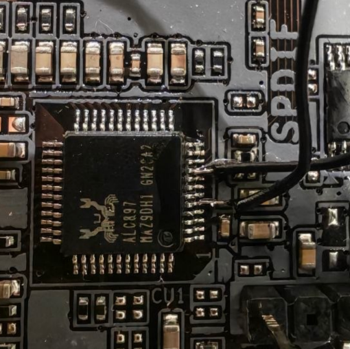

# 2. Puente FDO en el ALC897: montaje, efectos y recuperación

Español · [English](en/02-fdo-recovery.md)

Este montaje pertenece a la **Gigabyte Q670M D3H DDR4 rev. 1.1 con Realtek ALC897** estudiada. En otra revisión puede cambiar el códec, la ruta de la señal o la alimentación.

El montaje da acceso de mantenimiento para **cambiar PrivacyLevel o recuperar una imagen propia**. Si tu placa está sana, sigue el [recorrido directo Enhanced → Default](00-cambiar-privacy-level.md); no hay que provocar una avería ni restaurar ME antes de empezar.

## Por qué utilizamos el chip de audio

Intel documenta HDA_SDO como una señal de strap para Flash Descriptor Security Override en esta familia de PCH: importa el nivel de la señal en el momento de muestreo del arranque. El códec de audio nos proporcionó un punto accesible de esa conexión. [Intel 600 Series PCH: Pin Straps](https://edc.intel.com/content/www/us/en/design/ipla/software-development-platforms/client/platforms/alder-lake-desktop/intel-600-series-chipset-family-platform-controller-hub-pch-datasheet-volume/004/pin-straps/).

No se estaba reparando el audio ni usando su memoria como BIOS.

## Montaje utilizado y mediciones

Se identificaron en nuestro ALC897:

| Punto | Uso en el montaje del caso |
| --- | --- |
| Pin 5 | HDA_SDO / señal de override |
| Pin 9 | DVDDIO, medido aproximadamente a 3,43 V |
| Entre ambos | Resistencia de 2 kΩ y dos hilos finos |

~~~text
ALC897: pin 9, DVDDIO ---- resistencia 2 kΩ ---- pin 5, HDA_SDO
~~~

**No es un cortocircuito directo entre patas:** la resistencia está en serie entre los dos hilos. No se añade alimentación desde USB, una fuente externa ni la salida GEN del osciloscopio.

### Foto real de los dos puntos soldados

La foto muestra los puntos de conexión antes de cerrar el circuito con la resistencia; **la resistencia no aparece en la imagen**. En esta orientación, la marca de pin 1 está en la esquina inferior derecha: contando las patas del lado derecho desde abajo hacia arriba, el hilo inferior corresponde al pin 5 y el superior al pin 9. Usa esa referencia solo junto a la identificación del encapsulado de tu placa; no cuentes a partir de los hilos o de las soldaduras.

La resistencia no tiene polaridad. La numeración debe comprobarse desde la marca de pin 1 del encapsulado y su documentación; la orientación de una fotografía girada no es una referencia suficiente. La medida de 3,43 V es la obtenida en esta placa, no un valor que deba aplicarse desde una fuente externa.

Para preparar o abrir la conexión se apagó el equipo, se desconectó la fuente de la red y se esperó a que desapareciera la alimentación residual. Se aislaron las uniones. La conexión se mantuvo durante el arranque de recuperación y se abrió sin corriente antes del arranque normal.

El osciloscopio se usó como instrumento de medida; su salida GEN no alimentó el circuito. Una lectura previa de unos 5,12 V correspondía a la alimentación USB y no se utilizó para polarizar HDA_SDO. Con un osciloscopio de banco, su pinza de masa debe ir a una masa identificada de la placa; no debe conectarse a un pin arbitrario.

## Cómo afecta al equipo

El nivel de HDA_SDO se utiliza como condición de arranque del PCH. El montaje mantiene la señal hacia su alimentación digital mediante una resistencia para solicitar el override. No programa la política de privacidad, ni escribe la flash por sí solo.

| Fase | Montaje | Alimentación y objetivo |
| --- | --- | --- |
| Preparar o modificar los hilos | Se instala o abre | Fuente desenchufada; no manipular patas energizadas |
| Arranque de mantenimiento | Cerrado mediante 2 kΩ | Arrancar Linux live y comprobar FDO antes de escribir |
| Lectura/escritura/verificación | Se conserva el montaje | Completar copias y readback; no retirar en caliente |
| Salida de mantenimiento | Se abre después del apagado | Desenchufar fuente y aislar extremos |
| Arranque de uso normal | Abierto | CSME normal y prueba de privacidad/KVM |

En nuestra unidad, el arranque con FDO dejaba CSME en modo 4 y sin su inicialización normal. Por eso podía faltar MEI y no funcionaba AMT para medir la política. En un arranque averiado también llegaron a faltar NVMe/red; su ausencia por sí sola no demuestra un fallo físico.

La conexión se abre después de terminar el trabajo para volver al modo normal. **Abrirla no revierte los datos de firmware que se hayan escrito.** Para deshacer un cambio de datos hace falta restaurar la copia correspondiente y verificarla.

La funcionalidad del audio después de retirar el montaje no se documentó como una prueba separada. Evita interpretar el uso temporal de esa señal como garantía de funcionamiento normal del códec con el montaje conectado.

## Comprobar que FDO está realmente activo

En este equipo se observaron:

| Indicador | Arranque con FDO | Arranque normal final |
| --- | --- | --- |
| FDOPSS | 0 | 1 |
| FRACC | 0xffff | 0x4acf |
| CSME | Modo 4, override; sin inicialización normal | Modo 0, Normal |
| MEI/HECI | No disponible en el arranque de mantenimiento observado | Disponible |

Estos son valores del controlador y de la plataforma del caso, no direcciones universales ni instrucciones para modificar registros. Se verificaron permisos y estado antes de intentar escribir.

**No se evaluó el resultado final de AMT con la resistencia conectada.** Primero se terminó la escritura y se guardaron las copias; después se abrió FDO y se comprobó un arranque normal.

## Copias y recuperación, solo si necesitas restaurar el estado anterior

La secuencia siguiente corresponde al equipo que habíamos dejado con ME sin inicializar. Para una placa sana que parte de Enhanced, conserva el respaldo funcional y pasa a preparar el candidato Default; no ejecutes una restauración innecesaria.

1. Se leyeron **dos veces los 32 MiB completos** de la SPI con FDO activo. Ambas lecturas fueron idénticas.
2. Se compararon descriptor, GbE, BIOS y la región adicional con las copias anteriores.
3. Se restauró la región ME de la **copia propia anterior al daño**.
4. El escritor original comprobó cada sector y contemplaba restauración de su preimagen si fallaba la operación.
5. Se releyó toda la flash y se verificó que solo había cambiado la zona prevista.
6. Se guardaron resultados y copias en el USB y en otro ordenador antes del apagado.

La restauración de la copia propia escribió 106 sectores de 4 KiB. Recuperó la base funcional; el cambio de privacidad se hizo después y escribió 116 sectores distintos respecto a su fuente. Estos recuentos documentan dos intervenciones separadas.

En el primer estado averiado no aparecía el NVMe. Después de restaurar ME volvió a detectarse. Por tanto, la ausencia del disco no justificaba formatearlo ni reinstalar Proxmox.

## Cómo se salió de FDO

Se apagó ordenadamente y se desconectó la fuente. El usuario abrió la conexión cortando un tramo libre de uno de los hilos, lejos de las patas del códec, y aisló ambos extremos. Esto permitió dejar los puntos soldados disponibles para una recuperación futura sin mantener el override activo.

El arranque normal final mostró HFSTS1=0x90000245, estado de trabajo 5, modo 0, inicialización completa y error 0. Volvieron MEI, NVMe y el funcionamiento normal de Proxmox.

## Lo que no fue necesario

No se desoldó el chip M_BIOS. En esta placa se identificó un **Macronix MX25L25673GZ4I-08G, WSON de ocho contactos, 32 MiB y 3,3 V**: sus contactos inferiores no se agarran como las patas expuestas de un SOIC8.

La huella vacía EC_BIOS no se trató como un conector de programación. Una huella sin componente necesita esquema o comprobaciones eléctricas para determinar su función.
