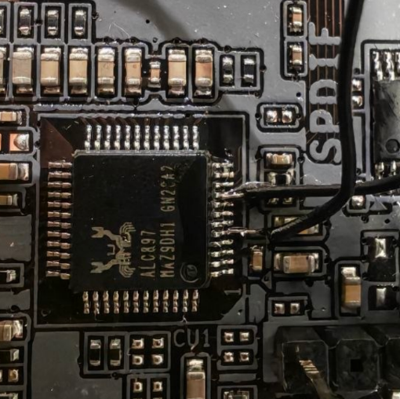

# 2. ALC897 FDO connection: wiring, effects and recovery

[Español](../02-fdo-recuperacion.md) · [English home](../../README.en.md)

This setup belongs to the documented **Gigabyte Q670M D3H DDR4 rev. 1.1 with Realtek ALC897**. Another revision may use a different codec, signal routing or supply.

The connection provides maintenance access for **changing PrivacyLevel or restoring your own image**. If the motherboard works, follow the [Enhanced → Default workflow](00-change-privacy-level.md); there is no need to cause a failure or restore ME first.

## Why the audio chip was involved

Intel documents HDA_SDO as a strap signal for Flash Descriptor Security Override on this PCH family: its level at the boot-time sampling point matters. The audio codec provided an accessible point on that connection. [Intel 600 Series PCH: Pin Straps](https://edc.intel.com/content/www/us/en/design/ipla/software-development-platforms/client/platforms/alder-lake-desktop/intel-600-series-chipset-family-platform-controller-hub-pch-datasheet-volume/004/pin-straps/).

We were not repairing audio or using its memory as the BIOS.

## Wiring and measurements used in this case

The following points were identified on our ALC897:

| Point | Role in the case setup |
| --- | --- |
| Pin 5 | HDA_SDO / override signal |
| Pin 9 | DVDDIO, measured at approximately 3.43 V |
| Between them | A 2 kΩ resistor and two fine wires |

~~~text
ALC897: pin 9, DVDDIO ---- 2 kΩ resistor ---- pin 5, HDA_SDO
~~~

**This is not a direct short between pins:** the resistor is in series between the two wires. Do not add power from USB, an external supply or the oscilloscope's GEN output.

### Original photograph of the two soldered points

The photograph shows the connection points before completing the circuit through the resistor; **the resistor is not visible in the image**. In this orientation, the pin 1 mark is at the lower-right corner. Counting the pins on the right side from bottom to top, the lower wire corresponds to pin 5 and the upper wire to pin 9. Use that reference together with identification of the actual package on your board; do not count from the wires or solder joints.

The resistor has no polarity. Confirm numbering from the package's pin 1 mark and its documentation; a rotated photograph is not sufficient on its own. The 3.43 V reading was measured on this board, not a voltage to apply from an external source.

To prepare or open the connection, the system was shut down, the PSU was unplugged from mains power, and residual power was allowed to disappear. Joints were insulated. The connection stayed in place during the recovery boot and was opened with power removed before normal boot.

The oscilloscope was used for measurement; its GEN output did not power the circuit. An earlier reading of approximately 5.12 V came from the USB supply and was not used to bias HDA_SDO. With a bench oscilloscope, its ground clip must connect to an identified board ground, not an arbitrary pin.

## How the connection affects the system

The PCH uses the level on HDA_SDO as a boot condition. This setup pulls the signal toward its digital supply through a resistor to request override. It does not program privacy policy or write flash by itself.

| Stage | Connection | Power state and purpose |
| --- | --- | --- |
| Prepare or modify the wires | Install or open it | PSU unplugged; do not work on powered pins |
| Maintenance boot | Closed through 2 kΩ | Boot live Linux and verify FDO before writing |
| Read/write/verify | Keep the setup in place | Finish backups and readback; do not remove it while powered |
| Leave maintenance mode | Open it after shutdown | Unplug the PSU and insulate the ends |
| Normal use | Open | Normal CSME and privacy/KVM checks |

On our unit, the FDO boot left CSME in mode 4 without normal initialization. MEI could therefore be absent, and AMT was unavailable for querying policy. NVMe/network devices also disappeared during a failed boot; their absence alone does not establish physical failure.

The connection is opened after maintenance to return to normal mode. **Opening it does not revert firmware data already written.** Undoing a data change requires restoring the corresponding backup and verifying it.

Audio functionality after removing the connection was not recorded as a separate test. Do not interpret temporary use of this signal as a guarantee that the codec operates normally while the connection remains in place.

## Verify that FDO is actually active

The following values were observed on this system:

| Indicator | FDO boot | Final normal boot |
| --- | --- | --- |
| FDOPSS | 0 | 1 |
| FRACC | 0xffff | 0x4acf |
| CSME | Mode 4, override; no normal initialization | Mode 0, Normal |
| MEI/HECI | Unavailable during the observed maintenance boot | Available |

These are controller/platform values from the case, not universal addresses or instructions for modifying registers. Permissions and state were checked before attempting a write.

**AMT's final behavior was not evaluated with the resistor connected.** Writing was completed and backups were saved first; FDO was then opened and a normal boot was checked.

## Backups and recovery, only when restoring the previous state

The following sequence describes the unit whose ME we had left uninitialized. For a healthy board starting with Enhanced, retain a working backup and proceed to preparing the Default candidate; an unnecessary restoration is not part of that workflow.

1. Read the **entire 32 MiB SPI twice** with FDO active. Both reads were identical.
2. Compare the descriptor, GbE, BIOS and additional region against earlier backups.
3. Restore the ME region from **our own backup made before the damage**.
4. The original writer checked every sector and provided for restoring its preimage if the operation failed.
5. Read the whole flash again and verify that only the intended area changed.
6. Save results and backups on the USB and a second computer before shutdown.

Restoring our own ME backup wrote 106 sectors of 4 KiB. That recovered the working baseline. The later privacy change wrote 116 sectors that differed from its source. These counts refer to two separate interventions.

The NVMe was absent in the initial failed state and reappeared after restoring ME. Its absence did not justify formatting it or reinstalling Proxmox.

## Leaving FDO

The system was shut down normally and the PSU was unplugged. The owner opened the circuit by cutting a free section of one wire, away from the codec pins, and insulated both cut ends. This left the soldered access points available for future recovery without keeping override active.

The final normal boot reported HFSTS1=0x90000245, working state 5, operating mode 0, initialization complete and error 0. MEI, NVMe and normal Proxmox operation returned.

## What was unnecessary

The M_BIOS chip was not desoldered. This board's flash was identified as a **Macronix MX25L25673GZ4I-08G, eight-contact WSON, 32 MiB, 3.3 V**. Its underside contacts cannot be gripped like exposed SOIC8 leads.

The unpopulated EC_BIOS footprint was not treated as a programming header. A bare footprint requires a schematic or electrical checks to establish its function.
